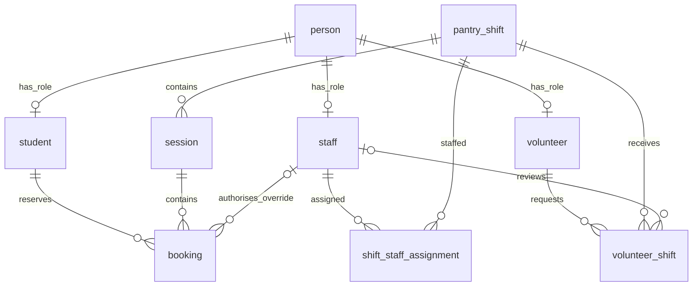
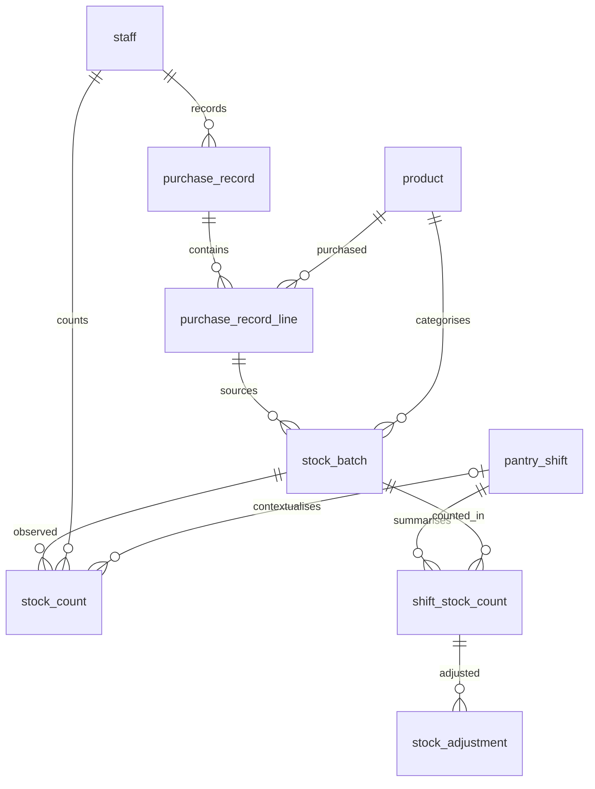

# Campus Pantry - Group 94 Project Report

COMP9120  /  SEMESTER 2, 2026  /  GROUP 94

Campus Pantry
FoodHub database
project report

Ziyue Wu, Nikhil Khatri and Samowel Aboud
Final submission and showcase revision - 24 October 2026

### Project purpose

Campus Pantry connects student food-collection reservations, attendance, staff and volunteer rosters, and stock records. A shared PostgreSQL database lets the group demonstrate relational design, integrity constraints, transactions and analytical SQL through a Python command-line interface.

### Final implementation

| Design | Verified release |
| --- | --- |
| 16 base tables and 3 views | Python 3.12.14, PostgreSQL 16.15, psycopg2-binary 2.9.10 |
| 12 analytical query groups | 13 SELECT result sets, including two roster queries in Q8 |
| 44 automated test cases | All passed twice, with 10 coordinated concurrency scenarios |
| Operational demonstration | Isolated booking, approval, attendance and stock workflow |

### Report structure

1. Problem definition and requirements
2. Conceptual entity-relationship model
3. Logical mapping and normalisation analysis
4. SQL implementation, transactions, reporting and validation

### Scope of this submission

This report describes the final local university showcase release. UniKey selection is simulated sign-in and tokens appear in the terminal. Real university authentication, email delivery and QR-image scanning are outside the implemented scope. The data is synthetic. The revised code, report and evidence replace earlier prototype claims.

The recorded video and contribution form accompany this report as separate files. The group must confirm contribution details and complete the required signatures. This report makes no individual participation attestation.


## Problem and requirements

Section 1

### Problem definition

Food collections require coordinated demand, staffing and stock information. A booking alone does not show that a student attended, and a purchase quantity alone does not show the latest physical balance. Campus Pantry stores these distinct events and links them through keys so operators can assess capacity, roster coverage, stock variance and purchasing needs.

| Stakeholder | Supported task |
| --- | --- |
| Student | Reserve one standard session per day, view bookings and cancel before the session ends. |
| Volunteer | Request a shift, view its decision and withdraw a pending request. |
| Staff | Set up days, assign duties, open/close shifts, review volunteers, check in tokens, record stock and run reports. |

| ID | Requirement and implementation boundary |
| --- | --- |
| R1 | Daily setup creates three two-hour shifts and twelve half-hour sessions from 10:00 to 16:00 Sydney time. |
| R2 | Capacity is between 1 and 50. Every non-CANCELLED booking consumes a place. A normal student has at most one such booking per date. |
| R3 | An active staff member may authorise an extra daily booking with a nonblank reason. Capacity still applies. |
| R4 | Check-in accepts the booking date only, from 10:00 inclusive to 16:00 exclusive. Same-day late arrivals remain valid after the original shift closes. |
| R5 | Exactly one active main supervisor and one active assistant are needed to open a shift. Staffing is fixed after opening. One staff member cannot have overlapping assignments. |
| R6 | Volunteer requests are PENDING, APPROVED or REJECTED. Decisions affect pending requests only; pending/approved requests cannot overlap for one volunteer. |
| R7 | Record real opening and closing counts. Dispensing is estimated as opening + receipts - waste - closing. Completed shift stock cannot be edited. |
| R8 | The database retains purchase, batch, count and attendance relationships; reports distinguish reservations, observations and inferred quantities. |

### Policy and model assumptions

Roles may overlap: a volunteer can also be a student. Opening/closing times and service-level actor checks are enforced by the application; structural constraints are enforced in PostgreSQL. Staff/volunteer overlap is checked within each role table. The implementation does not impose an additional cross-role overlap rule. Shift scheduling is immutable after creation. Correcting a schedule requires replacement records.


## Identity, bookings and rosters

Section 2 - conceptual ER model, panel A

Entities are named conceptually below. Cardinalities describe permitted records; each dependent row references exactly one parent unless the audit relationship is optional. Person roles use overlapping, optional specialisation.

Figure 1. Operational domain: nine of the sixteen entities. The Shift, Staff and Person identities connect this panel to the inventory domain on the next page.

| Audit relationship | Cardinality |
| --- | --- |
| Staff authorises a Booking override | One staff member may authorise 0..N bookings; a booking names 0..1 override staff. |
| Staff reviews a Volunteer request | One staff member may review 0..N requests; a request names 0..1 reviewer. |

Opening a shift strengthens the diagram's general 0..N assignment cardinality to exactly two staff assignments: one of each duty. A single person may hold several role memberships, while assignment uniqueness prevents the same staff member from filling both duties on one shift.




## Purchasing and inventory

Section 2 - conceptual ER model, panel B

Purchases contain product lines. Each stock batch traces to one purchase line and the same product. Physical counts are observations; shift summaries and adjustment totals support reconciliation. They do not record which individual received each item.

Figure 2. Inventory domain: the remaining seven entities. The direct Product-Batch relationship is retained redundancy, protected by a composite foreign key.

| Cross-panel relationship | Cardinality / optionality |
| --- | --- |
| Staff records Purchase record | Each purchase has 1 recorder; staff may record 0..N purchases. |
| Staff performs Stock count | Each count has 1 recorder; staff may perform 0..N counts. |
| Pantry shift links Stock count | A count may reference 0..1 shift; a shift may have 0..N counts. |
| Pantry shift links Shift stock count | Each shift/batch summary has 1 shift; a shift may have 0..N summaries. |




## Relational mapping: operations

Section 3 - logical design, panel A

Figure 3. Complete operational relation schemas. PK = primary key, FK = foreign key, UQ = unique alternate key. Fields shown after the key line list all remaining stored attributes; composite keys also appear in attribute lists for clarity. Reference targets use the target primary key unless a named pair is shown.

### person

PK unikey

full_name, email, contact

UniKey has four lower-case letters and four digits.

### student

PK/FK unikey -> person.unikey

degree_level, student_category

Role key shares the Person identity.

### staff

PK/FK unikey -> person.unikey; UQ staff_code

staff_code, is_active

Staff code is an alternate candidate key.

### volunteer

PK/FK unikey -> person.unikey

is_active

Optional role membership; active flag guards service actions.

### pantry_shift

PK shift_id; UQ (shift_date, start_time)

shift_date, start_time, end_time, status

PLANNED / OPEN / CLOSED.

### session

PK session_id; FK shift_id -> pantry_shift; UQ (session_date, start_time)

shift_id, session_date, start_time, end_time, capacity

Capacity 1..50; session fits parent shift.

### shift_staff_assignment

PK (shift_id, staff_unikey); UQ (shift_id, assignment_role)

shift_id, staff_unikey, assignment_role

FK shift_id -> pantry_shift; staff_unikey -> staff.

### volunteer_shift

PK (shift_id, volunteer_unikey)

shift_id, volunteer_unikey, status, request_date, reviewed_by_staff, reviewed_at

FK shift_id -> pantry_shift; volunteer_unikey -> volunteer; reviewed_by_staff -> staff (nullable).

### booking

PK booking_id; UQ qr_token

student_unikey, session_id, status, qr_token, created_at, attendance_at, admin_override, override_by_staff, override_reason

FK student_unikey -> student; session_id -> session; override_by_staff -> staff (nullable).


## Relational mapping: inventory

Section 3 - logical design, panel B

Figure 4. Complete inventory relation schemas. Numeric quantities use integers; unit_cost uses numeric(10,2). Identifiers use generated integer/bigint identities except UniKeys and generated stock-number strings. The canonical DDL defines exact types, lengths, nullability and constraints.

### purchase_record

PK purchase_id; FK recorded_by_staff -> staff

recorded_by_staff, purchase_date, reference, notes

Reference is descriptive, not a unique business key.

### product

PK product_id; UQ product_code

product_code, product_name, category, counting_unit, low_stock_threshold

Threshold is nonnegative.

### purchase_record_line

PK purchase_line_id; UQ (purchase_line_id, product_id)

purchase_id, product_id, quantity, unit_cost

FK purchase_id -> purchase_record; product_id -> product. Quantity > 0; cost nullable/nonnegative.

### stock_batch

PK stock_number; FK product_id -> product

product_id, purchase_line_id, batch_code, received_on, expires_on, received_qty

Composite FK (purchase_line_id, product_id) -> purchase_record_line. Expiry nullable; not before receipt.

### stock_count

PK stock_count_id

stock_number, shift_id, counted_by_staff, counted_at, count_type, counted_qty, notes

FK stock_number -> stock_batch; shift_id -> pantry_shift (nullable); counted_by_staff -> staff.

### shift_stock_count

PK (shift_id, stock_number)

shift_id, stock_number, opening_qty, closing_qty, opening_variance_reason

FK shift_id -> pantry_shift; stock_number -> stock_batch. Closing can be null before closure.

### stock_adjustment

PK (shift_id, stock_number, adjustment_kind)

shift_id, stock_number, adjustment_kind, quantity, reason

Composite FK (shift_id, stock_number) -> shift_stock_count. Kind RECEIPT/WASTE; positive quantity.

### Mapping decisions

The shared primary-key role tables implement overlapping Person roles without duplicating identity fields. Associative tables resolve staff-to-shift and volunteer-to-shift many-to-many relationships. The shift/batch summary uses a composite identity, and each adjustment depends on that whole identity plus its kind.

A stock count may be a standalone spot check, which explains its nullable shift reference. Purchase lines have a surrogate key because the implementation permits several lines for the same product in a purchase. No uniqueness rule on (purchase_id, product_id) is assumed.


## Normalisation and trade-offs

Section 3 - dependency analysis

### Method

Normalisation is assessed against the model's functional dependencies, not merely the existence of primary keys. Atomic columns and separate relation rows avoid repeating groups. Identity, role, product and relationship facts are separated so that changing a name or product description does not require changing every booking or stock observation.

| Relation / dependency | Assessment and consequence |
| --- | --- |
| person: unikey -> full_name, email, contact | The declared identity determines its descriptive attributes. Email is not declared unique, so it is not assumed to be another key. |
| staff: unikey <-> staff_code; each -> is_active | UniKey and staff_code are candidate keys. The role table carries only staff facts. Student and volunteer tables follow their own UniKey role identity. |
| booking: booking_id <-> qr_token; each -> other attributes | Booking identity and the unique token identify the record. Student/date uniqueness is conditional across a join and can be overridden; it is not an unconditional candidate key. |
| shift_staff_assignment: (shift_id, staff_unikey) and (shift_id, assignment_role) | Both pairs identify a row. Duty depends on the whole assignment. Repeating the same valid assignment is supported. |
| shift_stock_count and stock_adjustment | Opening/closing depend on the shift/batch pair. Adjustment quantity and reason depend on that pair plus kind, avoiding duplicated per-kind columns. |
| stock_batch: purchase_line_id -> product_id | Retaining product_id introduces a transitive dependency because one purchase line may source several batches. This relation is not claimed to be in 3NF or BCNF. A composite FK enforces consistency. |
| session: shift_id -> session_date under the date rule | A shift may have several sessions, so shift_id is not a session key. Repeating the date is another deliberate redundancy; validation checks the parent date and scheduling fields are immutable. |

### Redundancy and derived values

Removing stock_batch.product_id and deriving the product through the purchase line would eliminate that transitive dependency. Likewise, session_date could be obtained from its shift. This release preserves the original table/API design and documents both choices, rather than making a blanket BCNF claim.

stock_count preserves observations, while shift_stock_count stores an operational opening/closing pair. This duplicates selected measurements across relations for reporting. The service updates both in one transaction. Database owners can still write direct SQL, so the release does not claim a complete immutable event ledger or formal normal-form certification for every business dependency.


## Integrity and transactions

Section 4 - SQL implementation

| Rule | Mechanism |
| --- | --- |
| Entity and reference integrity | PK, UNIQUE and FK constraints; shared role keys; composite purchase-line/product FK. |
| Valid domain values | CHECK constraints for statuses, positive/nonnegative quantities, capacity 1..50, UniKey/stock formats and attendance/override metadata. |
| Booking rules | BEFORE INSERT/UPDATE trigger locks student then session, checks capacity and same-date standard booking limit, and validates audit metadata on every write. |
| Roster integrity | Per-person locks serialize overlap checks. Shift locks coordinate staffing, scheduling and lifecycle changes. Staff assignments freeze after opening. |
| Parent edits and closure | Immutable schedule fields prevent child schedule drift; capacity cannot fall below bookings. Closing needs all recorded closing counts and nonnegative dispensing. |
| Service policies | Active acting roles, real-time Sydney check-in, non-stale review, honest count order, cancellation deadline and readable errors. |

### Booking transaction

The service locks the student record first, validates identity and any override, then locks the selected session. It checks the session's day and end time, creates a random token and inserts the booking. The trigger reuses the same lock order, validates current counts and commits only a valid row. A rejected operation rolls back. This avoids two simultaneous requests both claiming one remaining place.

### Stock transaction

The acting staff role and shift are checked, then the shift/batch summary is locked. A closing count requires an actual opening, includes receipts and waste in the available balance, and rejects an impossible closing quantity. The observation and summary update commit together. A shift-level lock prevents a concurrent closure from passing an inventory write. Closed stock data cannot be inserted, edited or deleted through ordinary DML.

### Representative declarative constraint

```text
FOREIGN KEY (purchase_line_id, product_id)
REFERENCES purchase_record_line(purchase_line_id, product_id)
```

This constraint prevents a batch and its purchase line from naming different products, including after a parent product edit. It protects retained redundancy rather than removing it.

### Failure handling and operational limits

The service commits once per operation and translates database errors after rollback. It makes at most three attempts for serialization/deadlock SQLSTATEs. Connections have bounded waits, and no silent alternate-port fallback. SQL demonstrations roll back table changes; sequence increments may still advance. Tests use disposable databases so this behaviour cannot affect normal showcase records. Indexes support lookup predicates, but no measured speedup or load capacity is claimed.


## Reporting and worked example

Section 4 - analytical SQL

Three views separate operational interpretation from raw rows: v_booking_attendance, v_latest_stock_count and v_shift_stock_report. Latest counts use counted_at followed by stock_count_id to break ties. Estimated dispensing appears only for closed shifts with a closing count.

| Query | Question answered / SQL feature |
| --- | --- |
| Q1 | Shift stock reconciliation using v_shift_stock_report. |
| Q2 | Estimated dispensing by product across closed shifts; GROUP BY and SUM. |
| Q3 | Latest physical observation for each counted batch; DISTINCT ON view. |
| Q4 | Products below thresholds from latest batch counts; CTEs and outer join. |
| Q5 | Session capacity, reservations and attendance through the booking view. |
| Q6 | Opening variance against the preceding closed shift; LATERAL previous-row lookup. |
| Q7 | Products with no positive dispensing in the selected data; NOT EXISTS. |
| Q8 | Staff roster and approved volunteer roster; two SELECT result sets. |
| Q9 | Purchased quantities and known line cost by date/product; joins and aggregates. |
| Q10 | Attendance percentage by session; FILTER and NULLIF for zero denominators. |
| Q11 | Batches expiring within the next 30 days; CURRENT_DATE range. |
| Q12 | Sessions at or above 80% capacity; CEIL and safe division. |

### Reconciliation example from the repeatable showcase

| Opening | Receipt | Waste | Closing | Estimated dispensed |
| --- | --- | --- | --- | --- |
| 100 packs | 10 packs | 2 packs | 88 packs | 20 packs |

100 + 10 - 2 - 88 = 20. These are synthetic observations in the isolated demonstration. The result estimates dispensing, not measured item-level distributions. A physical loss not entered as waste can also appear in the residual, so operational interpretation and reconciliation remain necessary.

### Interpreting report boundaries

Q4 treats products without a count as zero through COALESCE; a missing measurement should therefore be investigated, not assumed to prove an empty shelf. Q9 calls its result known_line_cost because NULL unit costs contribute zero. Q11 shows received_qty rather than a current balance. Historical seed dates mean expiry output changes with the current date. These distinctions prevent stronger claims than the data supports.


## Validation and reproduction

Section 4 - evidence and handover

| Executed evidence | Result |
| --- | --- |
| Full suite, run 1 | 44 passed, zero failures/errors/skips; 9.83s; owned database removed. |
| Full suite, run 2 | 44 passed, zero failures/errors/skips; 9.12s; different owned database removed. |
| Concurrency | 10 barrier-coordinated separate-connection scenarios per run, including direct SQL and mixed service/SQL requests. |
| SQL and reports | 23 expected-failure assertions; all table rows preserved around rollback examples; 12 query groups / 13 result sets checked against expected values. |
| Actual handover | Both psql setup wrappers initialise once and safely refuse reruns; 29 seed people remain. CLI staff login, stock report and logout succeed. |
| Showcase | Booking, duplicate rejection, volunteer approval, idempotent attendance, 20-pack reconciliation and cleanup all pass. |

### What the suite covers

Tests exercise the exact 50-place capacity limit, same-student daily collisions, audited override updates, parent schedule/capacity changes, active roles, repeated staffing assignments, competing reviews, missing/duplicate counts, closed-history edits, malformed input and rollback. Attendance tests include 10:00 and 16:00 boundaries, invalid-date tokens and a late arrival after the original shift closes. Expected-error checks do not accept unrelated exceptions as successful business-rule rejections.

### Run the delivered code

Use README.md for Python environment, PostgreSQL and credential setup. The normal CLI uses PGHOST, PGPORT, PGDATABASE and PGUSER. The safe test/demo runners use explicit TEST_PG target settings and a CREATEDB-capable role to create and remove only their own databases. Normal CLI time is real; showcase.py labels its simulated date/time.

```text
python tests/run_tests.py
python showcase.py
python campus_pantry_app/cli.py
```

### Limits, sources and acknowledgement

This is a fresh-install local showcase, not an existing-data migration or hosted service. UniKey identity selection is simulated. No SSO, mail delivery or QR imaging is integrated. Direct database owners can bypass service-only policies. Adjustment quantities aggregate by kind and keep the latest reason. No load test, security certification or backup/restore drill is claimed. The video and contribution form are separate files; group confirmation and required signatures remain the group's responsibility.

Source basis: final campus_pantry_sql/01_schema.sql through 06_failure_tests.sql; campus_pantry_app/services.py, cli.py and db.py; tests/test_release.py; evidence/test-results-run-1.json and run-2.json; evidence/handover-checks.json; docs/showcase-transcript.txt. The supplied project brief defines the four report sections.

AI acknowledgement: OpenAI Codex assisted with review, implementation, test development and report preparation. Group members should review and understand the final materials and acknowledge assistance under unit requirements. The group remains responsible for submitted work. This statement does not certify individual contribution, sign-off or completed submission.
