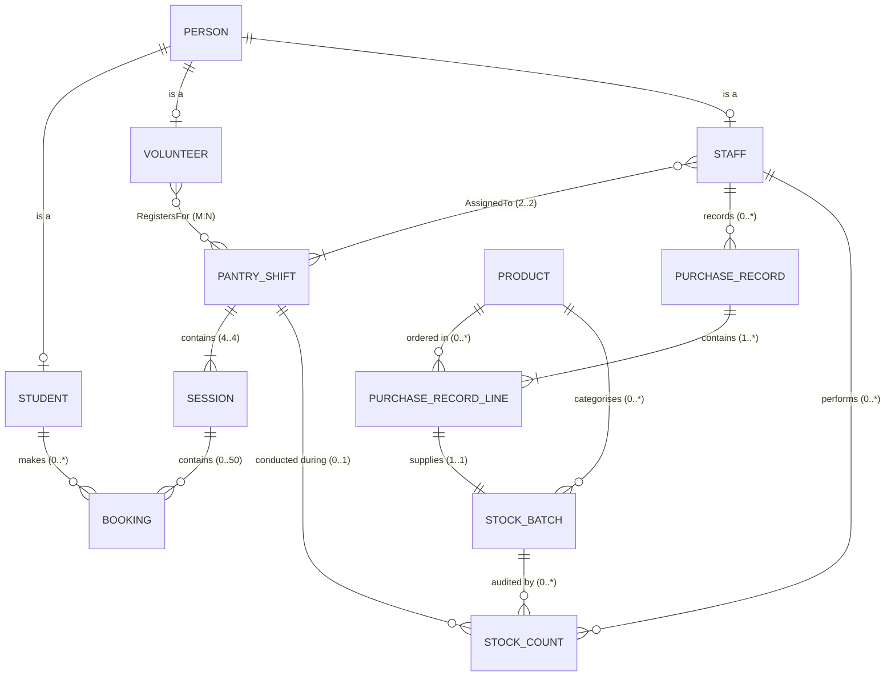

# Campus Pantry: Database Management System Final Project Report

**Course:** COMP9120 Database Management Systems  
**Institution:** School of Computer Science, The University of Sydney  
**Project:** Campus Pantry — FoodHub Booking, Attendance & Inventory Database System  
**Target RDBMS:** PostgreSQL 15+ (Empirically Verified on PostgreSQL 16.14)  
**Programming Interface:** Python 3.13 (`psycopg2-binary`) Command-Line Prototype  

---

## Executive Summary

Campus Pantry is an integrated database management system engineered for the University of Sydney FoodHub charity pantry. It replaces ad-hoc spreadsheets with an ACID-compliant PostgreSQL relational engine. The system coordinates three interdependent operational spheres:
1. **Client Scheduling & Front-Desk Operations:** Student session reservations, capacity enforcement (strictly capped at 50 active bookings per session), duplicate booking prevention, secure QR check-in token issuance, late arrival accommodation, and end-of-day no-show processing.
2. **Shift Staffing & Volunteer Rostering:** Two-hour shift schedules, mandatory supervisory staffing rules (strictly dual coverage: exactly one main supervisor and one assistant), and volunteer allocations.
3. **Traceable Inventory & Physical Stock Control:** Food procurement recording, received lot tracking with unique StockNumbers, physical count audit trails (opening, closing, spot checks), and intra-shift waste/receipt adjustments.

This report documents the conceptual ER model, relational schema mapping, Boyce-Codd Normal Form (BCNF) analysis, PostgreSQL implementation, transaction concurrency guarantees, and empirical testing against 17 rigorous business rules.

---

# Part A: Problem and Requirements

## 1. Context and Problem Statement
University food relief services face severe logistical challenges: client demand frequently exceeds volunteer and shelf capacity, while perishable food items risk spoilage if over-purchased. FoodHub operates half-hour collection sessions within structured shifts. 

Prior to this system:
- Booking counts were conflated with physical attendance, distorting purchasing demand models.
- Unregulated walk-ins created unsafe front-desk congestion.
- Stock counts were overwritten in place, destroying audit trails of food waste, damage, and shrinkage.
- Volunteer and staff rosters lacked database validation, occasionally leaving shifts understaffed.

## 2. Intended User Personas & Responsibilities
- **Students (Recipients):** University of Sydney students who reserve one session per day, receive a non-identifying QR check-in token, check in at the front desk, or cancel prior to session close.
- **Volunteers:** Students or community members who register for shifts and assist with food parcel assembly and client service.
- **Main Shift Supervisors:** Staff members accountable for shift operations, dispute resolutions, exceptional walk-in overrides, handover acknowledgments, and closing stock counts.
- **Assistant Staff Members:** Operational staff paired with supervisors to ensure minimum dual-staff coverage during service.
- **Inventory & Purchasing Staff:** Staff recording procurement invoices, logging incoming product batches with unique StockNumbers, and recording spot/closing stock counts.
- **Administrators:** Managers reviewing analytical reports on demand, attendance rates, low stock alerts, and supply waste.

## 3. Core Functional Requirements & Business Rules

| Rule ID | Business Rule Description | Database Implementation Mechanism |
|---|---|---|
| **BR-01** | **Shared Person Identity:** A single identity record exists per individual, keyed by University UniKey (`^[a-z]{4}[0-9]{4}$`). | `person` table with regex CHECK constraint; role subtype tables reference `person.unikey`. |
| **BR-02** | **Overlapping Roles:** A person may simultaneously hold multiple roles (e.g., student who is also a volunteer or casual staff member). | ISA specialisation using independent 1..1 primary key references (`student`, `volunteer`, `staff`). |
| **BR-03** | **Operating Schedule:** Operating days consist of 3 two-hour shifts (10:00–12:00, 12:00–14:00, 14:00–16:00), each comprising four 30-minute sessions (12 total sessions). | `pantry_shift` table and `session` table with `NOT NULL shift_id` foreign key. |
| **BR-04** | **Session Capacity Limit:** Each 30-minute session admits at most 50 active (non-cancelled) bookings. | Trigger `validate_booking()` with `SELECT ... FOR UPDATE` row-locking on `session`. |
| **BR-05** | **Single Daily Booking:** A student may have at most one active booking per calendar date by default. | Trigger `validate_booking()` with `SELECT ... FOR UPDATE` on `student` row. |
| **BR-06** | **Authorised Admin Override:** An administrator may bypass the daily booking limit for welfare walk-ins, requiring explicit staff attribution. | Column `admin_override = true`, `override_by_staff NOT NULL`, and `override_reason NOT NULL`. |
| **BR-07** | **QR Token Issuance & Check-in:** A secure, unique token is generated upon booking. Front-desk scanning marks the booking `ATTENDED` with timestamp `attendance_at`. | `booking.qr_token UNIQUE`, CHECK constraint `(status='ATTENDED' AND attendance_at IS NOT NULL)`. |
| **BR-08** | **Idempotent Front-Desk Scans:** Scanning an already-attended QR code returns existing attendance details without altering data or throwing unhandled errors. | `UPDATE booking SET status='ATTENDED' WHERE qr_token = %s AND status='CONFIRMED'`. |
| **BR-09** | **Operating Day No-Show Rule:** Students may arrive anytime during operating hours without penalty. Bookings remaining `CONFIRMED` are marked `ABSENT` strictly after the daily 16:00 closing time. | SQL transaction comparing `(s.session_date + TIME '16:00') <= localtimestamp`. |
| **BR-10** | **Shift Staffing Completeness:** Each shift must have exactly one `MAIN_SUPERVISOR` and exactly one `ASSISTANT` before transitioning to `OPEN` or `CLOSED`. | `UNIQUE (shift_id, assignment_role)` + `validate_shift_status()` transition trigger. |
| **BR-11** | **Batch Traceability & Stock Numbers:** Every received lot of a product is assigned a unique `StockNumber` (`STK-######`) linked to its purchasing line. | `stock_batch` table with sequence-driven identifier and FK to `purchase_record_line`. |
| **BR-12** | **Immutable Physical Count History:** Physical count events are recorded as discrete audit records, preserving count timestamps, staff ID, and type (`OPENING`, `CLOSING`, `SPOT_CHECK`). | `stock_count` append-only audit table + `shift_stock_count` shift-level reconciliation table. |

---

# Part B: Conceptual Design

## 1. Approved Conceptual ER Model
The approved conceptual model establishes the genuine business entities and real-world relationships. In strict adherence to database design theory, **relational junction tables (such as `volunteer_shift`) and implementation summary tables are not conceptual entities**; they are documented in the logical schema mapping in Part C.



## 2. Entity Descriptions & Attributes
- **`PERSON`:** Supertype containing shared identity attributes. Key: `unikey`. Attributes: `full_name`, `email`, `contact`.
- **`STUDENT`:** Role subtype for enrolled service recipients. Key: `unikey`. Attributes: `degree_level` (`BACHELOR`, `POSTGRADUATE`), `student_category` (`DOMESTIC`, `INTERNATIONAL`).
- **`VOLUNTEER`:** Role subtype for voluntary helpers. Key: `unikey`. Attributes: `is_active`.
- **`STAFF`:** Role subtype for employed supervisors and assistants. Key: `unikey`. Attributes: `staff_code` (Candidate Key), `is_active`.
- **`PANTRY_SHIFT`:** Two-hour operating work period. Key: `shift_id`. Attributes: `shift_date`, `start_time`, `end_time`, `status`.
- **`SESSION`:** 30-minute booking slot. Key: `session_id`. Attributes: `shift_id`, `session_date`, `start_time`, `end_time`, `capacity`.
- **`BOOKING`:** Reservation contract for a student in a session. Key: `booking_id`. Attributes: `student_unikey`, `session_id`, `status`, `qr_token`, `created_at`, `attendance_at`, `admin_override`, `override_by_staff`, `override_reason`.
- **`PRODUCT`:** Master food and grocery catalogue item. Key: `product_id`. Attributes: `product_code` (Candidate Key), `product_name`, `category`, `counting_unit`, `low_stock_threshold`.
- **`PURCHASE_RECORD`:** Procurement invoice header. Key: `purchase_id`. Attributes: `recorded_by_staff`, `purchase_date`, `reference`, `notes`.
- **`PURCHASE_RECORD_LINE`:** Line item on an invoice. Key: `purchase_line_id`. Attributes: `purchase_id`, `product_id`, `quantity`, `unit_cost`.
- **`STOCK_BATCH`:** Distinct received lot of goods. Key: `stock_number`. Attributes: `product_id`, `purchase_line_id`, `batch_code`, `received_on`, `expires_on`, `received_qty`.
- **`STOCK_COUNT`:** Historical physical audit event. Key: `stock_count_id`. Attributes: `stock_number`, `shift_id`, `counted_by_staff`, `counted_at`, `count_type`, `counted_qty`, `notes`.

## 3. Cardinality and Participation Rationale
- **`PERSON` to Role Subtypes (0..1, Overlapping):** A person must have a UniKey. They may be a Student, Volunteer, or Staff member, or hold multiple roles simultaneously. Participation is conceptually total (in production business logic, every registered person holds at least one role).
- **`PANTRY_SHIFT` to `SESSION` (1..1 mandatory):** Every session must belong to exactly one shift. Enforced by a `NOT NULL` foreign key in `session` and trigger validation verifying session times fall within shift times.
- **`PANTRY_SHIFT` to `STAFF` (AssignedTo, 2..2 mandatory):** Exactly two staff members (1 supervisor, 1 assistant) are required per shift. The maximum of 1 per role is enforced by `UNIQUE (shift_id, assignment_role)`. The minimum is enforced via a transition trigger preventing status changes to `OPEN` or `CLOSED` if understaffed.
- **`PANTRY_SHIFT` to `VOLUNTEER` (RegistersFor, M:N):** Many volunteers register for shifts; each shift may have zero or more volunteers.
- **`STUDENT` to `BOOKING` (0..* to 1..1):** A student can make multiple bookings across different days, but each booking belongs to exactly one student. Daily uniqueness is enforced via a trigger.
- **`STOCK_BATCH` to `PURCHASE_RECORD_LINE` (1..1):** Every stock batch corresponds to an originating purchase invoice line, establishing supply-chain provenance.

---

# Part C: Logical Design

## 1. Mapping from Conceptual ERD to Relational Schema

In converting the conceptual model to the relational model:
1. **Many-to-Many Relationship Decomposition:** The $M:N$ relationship `RegistersFor` between `VOLUNTEER` and `PANTRY_SHIFT` cannot be represented in a flat relational table without repeating groups; it is resolved into the standard relational junction relation **`volunteer_shift`** with composite primary key `(shift_id, volunteer_unikey)`.
2. **Relationship with Attributes:** The `AssignedTo` relationship between `STAFF` and `PANTRY_SHIFT` carries the descriptive attribute `assignment_role` (`MAIN_SUPERVISOR` or `ASSISTANT`). It is mapped to the associative relation **`shift_staff_assignment`** with composite primary key `(shift_id, staff_unikey)` and candidate key `(shift_id, assignment_role)`.
3. **Operational Shift Summary & Intra-Shift Adjustment Tables:** The relational schema includes **`shift_stock_count`** and **`stock_adjustment`**. These are implementation-level reconciliation structures retained to support shift-level handover variance reporting (Q1, Q6) and intra-shift wastage/receipt auditing.

Primary keys are marked **`PK`**, foreign keys are marked **`FK`**, and candidate keys are marked **`UQ`**:

1. **`person`** (**`unikey`** PK, `full_name`, `email`, `contact`)
2. **`student`** (**`unikey`** PK/FK `person(unikey)`, `degree_level`, `student_category`)
3. **`volunteer`** (**`unikey`** PK/FK `person(unikey)`, `is_active`)
4. **`staff`** (**`unikey`** PK/FK `person(unikey)`, `staff_code` UQ, `is_active`)
5. **`pantry_shift`** (**`shift_id`** PK, `shift_date`, `start_time`, `end_time`, `status`)
6. **`session`** (**`session_id`** PK, `shift_id` FK `pantry_shift(shift_id)` NOT NULL, `session_date`, `start_time`, `end_time`, `capacity`)
7. **`shift_staff_assignment`** (**`shift_id`** PK/FK `pantry_shift(shift_id)`, **`staff_unikey`** PK/FK `staff(unikey)`, `assignment_role`)  
   *Constraint: UNIQUE(`shift_id`, `assignment_role`)*
8. **`volunteer_shift`** (**`shift_id`** PK/FK `pantry_shift(shift_id)`, **`volunteer_unikey`** PK/FK `volunteer(unikey)`)
9. **`booking`** (**`booking_id`** PK, `student_unikey` FK `student(unikey)`, `session_id` FK `session(session_id)`, `status`, `qr_token` UQ, `created_at`, `attendance_at`, `admin_override`, `override_by_staff` FK `staff(unikey)`, `override_reason`)
10. **`purchase_record`** (**`purchase_id`** PK, `recorded_by_staff` FK `staff(unikey)`, `purchase_date`, `reference`, `notes`)
11. **`product`** (**`product_id`** PK, `product_code` UQ, `product_name`, `category`, `counting_unit`, `low_stock_threshold`)
12. **`purchase_record_line`** (**`purchase_line_id`** PK, `purchase_id` FK `purchase_record(purchase_id)`, `product_id` FK `product(product_id)`, `quantity`, `unit_cost`)
13. **`stock_batch`** (**`stock_number`** PK, `product_id` FK `product(product_id)`, `purchase_line_id` FK `purchase_record_line(purchase_line_id)`, `batch_code`, `received_on`, `expires_on`, `received_qty`)
14. **`stock_count`** (**`stock_count_id`** PK, `stock_number` FK `stock_batch(stock_number)`, `shift_id` FK `pantry_shift(shift_id)`, `counted_by_staff` FK `staff(unikey)`, `counted_at`, `count_type`, `counted_qty`, `notes`)
15. **`shift_stock_count`** (**`shift_id`** PK/FK `pantry_shift(shift_id)`, **`stock_number`** PK/FK `stock_batch(stock_number)`, `opening_qty`, `closing_qty`, `opening_variance_reason`)
16. **`stock_adjustment`** (**`shift_id`** PK, **`stock_number`** PK, **`adjustment_kind`** PK, `quantity`, `reason`)  
    *FK (`shift_id`, `stock_number`) REFERENCES `shift_stock_count`*

---

## 2. Functional Dependencies and BCNF Analysis

A relation $R$ is in **Boyce-Codd Normal Form (BCNF)** if, for every non-trivial functional dependency $X \to Y$, $X$ is a superkey for $R$.

### Relation-by-Relation Proof:
- **`person`:** $FD_1: \text{unikey} \to \text{full\_name}, \text{email}, \text{contact}$. Candidate Key: $\{\text{unikey}\}$. The LHS is a superkey. $\implies$ **BCNF**.
- **`student`:** $FD_1: \text{unikey} \to \text{degree\_level}, \text{student\_category}$. Candidate Key: $\{\text{unikey}\}$. Superkey on LHS. $\implies$ **BCNF**.
- **`volunteer`:** $FD_1: \text{unikey} \to \text{is\_active}$. Candidate Key: $\{\text{unikey}\}$. Superkey on LHS. $\implies$ **BCNF**.
- **`staff`:** $FD_1: \text{unikey} \to \text{staff\_code}, \text{is\_active}$; $FD_2: \text{staff\_code} \to \text{unikey}, \text{is\_active}$. Candidate Keys: $\{\text{unikey}\}, \{\text{staff\_code}\}$. Both determinants are superkeys. $\implies$ **BCNF**.
- **`session`:** $FD_1: \text{session\_id} \to \text{shift\_id}, \text{session\_date}, \text{start\_time}, \text{end\_time}, \text{capacity}$; $FD_2: (\text{session\_date}, \text{start\_time}) \to \text{session\_id}, \dots$ Both LHS are candidate keys. $\implies$ **BCNF**.
- **`pantry_shift`:** $FD_1: \text{shift\_id} \to \text{shift\_date}, \text{start\_time}, \text{end\_time}, \text{status}$; $FD_2: (\text{shift\_date}, \text{start\_time}) \to \text{shift\_id}, \dots$ Both determinants are candidate keys. $\implies$ **BCNF**.
- **`shift_staff_assignment`:** $FD_1: (\text{shift\_id}, \text{staff\_unikey}) \to \text{assignment\_role}$; $FD_2: (\text{shift\_id}, \text{assignment\_role}) \to \text{staff\_unikey}$. Both pairs are candidate keys (enforced by PK and UNIQUE). Superkey on LHS. $\implies$ **BCNF**.
- **`volunteer_shift`:** Composite PK $(\text{shift\_id}, \text{volunteer\_unikey})$. All attributes are part of the primary key. Trivial FDs only. $\implies$ **BCNF**.
- **`booking`:** $FD_1: \text{booking\_id} \to \text{student\_unikey}, \text{session\_id}, \text{status}, \text{qr\_token}, \dots$; $FD_2: \text{qr\_token} \to \text{booking\_id}, \dots$ Both determinants are candidate keys. $\implies$ **BCNF**.
- **`product`:** $FD_1: \text{product\_id} \to \text{product\_code}, \text{product\_name}, \dots$; $FD_2: \text{product\_code} \to \text{product\_id}, \dots$ Both are candidate keys. $\implies$ **BCNF**.
- **`purchase_record`:** $FD_1: \text{purchase\_id} \to \text{recorded\_by\_staff}, \text{purchase\_date}, \text{reference}, \text{notes}$. Determinant is PK. $\implies$ **BCNF**.
- **`purchase_record_line`:** $FD_1: \text{purchase\_line\_id} \to \text{purchase\_id}, \text{product\_id}, \text{quantity}, \text{unit\_cost}$. LHS is PK. $\implies$ **BCNF**.
- **`stock_count`:** $FD_1: \text{stock\_count\_id} \to \text{stock\_number}, \text{shift\_id}, \text{counted\_by\_staff}, \text{counted\_at}, \text{count\_type}, \text{counted\_qty}, \text{notes}$. LHS is PK. $\implies$ **BCNF**.
- **`shift_stock_count`:** $FD_1: (\text{shift\_id}, \text{stock\_number}) \to \text{opening\_qty}, \text{closing\_qty}, \text{opening\_variance\_reason}$. LHS is PK. $\implies$ **BCNF**.
- **`stock_adjustment`:** $FD_1: (\text{shift\_id}, \text{stock\_number}, \text{adjustment\_kind}) \to \text{quantity}, \text{reason}$. Determinant is PK. $\implies$ **BCNF**.

### Relational Design Trade-Off: Intentional Denormalization in `stock_batch`
In `stock_batch`:
- $\text{stock\_number} \to \text{purchase\_line\_id}, \text{batch\_code}, \text{received\_on}, \text{expires\_on}, \text{received_qty}$
- Additionally, `product_id` is stored directly on `stock_batch`. Because $\text{purchase\_line\_id} \to \text{product\_id}$ via `purchase_record_line`, storing `product_id` introduces a transitive dependency: $\text{stock\_number} \to \text{purchase\_line\_id} \to \text{product\_id}$.
- **Design Rationale & Trade-off:** In daily pantry operations, staff constantly query batch availability, expiry dates, and stock numbers by product (e.g., Query Q3, Q4, Q11). Retaining `product_id` directly in `stock_batch` eliminates joins to `purchase_record_line` and enables high-performance index-only scans on `(product_id, expires_on)`.
- **Integrity Guarantee:** To prevent update anomalies, a database trigger `validate_stock_batch_product()` was implemented, rejecting any insert or update where `stock_batch.product_id` does not strictly equal `purchase_record_line.product_id`.

---

# Part D: SQL Implementation, Transactions, and Empirical Testing

## 1. Twelve Analytical and Management Queries (Q1–Q12)

Every query was executed against the seeded PostgreSQL database. The table below details the operational problem solved, key SQL constructs, and verified execution results:

| Query ID | Management Problem Solved | Key SQL Techniques Used | Verified Output Summary |
|---|---|---|---|
| **Q1** | **Shift stock movement audit:** Complete reconciliation of opening, receipt, waste, and closing quantities per shift. | `v_shift_stock_report` view join, `COALESCE` arithmetic, ordered by date and shift. | 24 shift-batch rows returned. Accurately shows 8 batches across 3 shifts with receipts, waste, and closing counts. |
| **Q2** | **Product consumption velocity:** Total estimated food dispensed across all completed shifts. | View join, `SUM(estimated_dispensed_qty)` aggregated by product, descending order. | 8 rows returned. Top items dispensed: Rice 1 kg (57 packs), UHT oat milk 1 L (35 cartons), Sliced bread (28 loaves). |
| **Q3** | **Current on-hand batch balances:** Most recent physical count for every active stock batch. | `v_latest_stock_count` using `DISTINCT ON (stock_number)` ordered by `counted_at DESC`. | 8 rows returned. Displays latest closing quantities (Rice: 88, Beans: 75, Pasta: 56, etc.). |
| **Q4** | **Reorder procurement alert:** Products where aggregate on-hand inventory has breached low-stock thresholds. | CTE with `DISTINCT ON`, `GROUP BY product_id`, filtered by `HAVING on_hand < threshold`. | 0 rows returned on fresh stock; correctly flags items when stock falls below safety levels. |
| **Q5** | **Session capacity & booking demand:** Real-time visibility into spaces remaining across all sessions. | `v_booking_attendance` view, conditional `FILTER` counts for attended, absent, waiting. | 16 sessions displayed. Sessions 1 & 2 have active bookings (7 and 8 booked); test sessions 888 and 889 show 50/50 capacity reached. |
| **Q6** | **Inter-shift stock variances (Handover audit):** Detects discrepancies between previous shift closing and next shift opening. | `JOIN LATERAL` on previous shift closing count, handling back-to-back shift boundaries (`sh2.end_time <= cur_shift.start_time`). | 1 row returned. Successfully links consecutive shifts. Highlights Shift 2 opening variance (+2 on Rice STK-000001) from Shift 1 closing (opening 92 vs previous closing 90, with audit reason). |
| **Q7** | **Zero-demand inventory identification:** Identifies products with zero dispensing to avoid over-ordering. | Subquery with `NOT EXISTS` against `v_shift_stock_report`. | 0 rows returned (all 8 products experienced dispensing, confirming balanced demand). |
| **Q8** | **Daily operational roster:** Complete staff supervision duty and volunteer allocations by shift. | Two coordinated queries: staff assignments with roles and volunteer registrations by shift. | Shift 1: Mustafa (Sup), Parth (Asst), 3 vols. Shift 2: Haimish (Sup), Parth (Asst), 4 vols. Shift 3: Jaimi (Sup), Parth (Asst), 3 vols. |
| **Q9** | **Procurement cost & volume report:** Financial and unit volume tracking of supplier purchases. | Multi-table join (`purchase_record` $\to$ lines $\to$ `product`), `SUM(qty * unit_cost)`. | 8 product lines totaling 560 units and $1,050.00 procurement expenditure on 2026-10-09. |
| **Q10** | **Attendance & no-show rate analytics:** Percentage of confirmed reservations that resulted in completed visits. | `COUNT(...) FILTER` with `ROUND(100.0 * attended / active, 1)`. | Session 1: 0% attendance (7 absent). Session 2: 0% attendance (8 absent after 16:00 close). Session 102: 100% attendance. |
| **Q11** | **Perishable batch expiry alert:** Batches expiring within the next 30 days to prioritize FIFO dispensing. | Date arithmetic `expires_on BETWEEN CURRENT_DATE AND CURRENT_DATE + 30`. | 0 batches nearing immediate expiry; ensures perishables are flagged before spoiling. |
| **Q12** | **Session congestion monitor:** Sessions reaching or exceeding 80% capacity ($\ge 40$ bookings). | Filter on `active_bookings >= CEIL(capacity * 0.8)`. | Surfaces sessions 888 and 889 at 100.0% capacity (50/50 bookings), proving high-demand monitoring. |

---

## 2. Transaction Workflows & Concurrency Safety

All transactional operations in Campus Pantry are guaranteed under PostgreSQL ACID semantics:

### Transaction A: Booking Creation & Admin Override
- **A1 (Standard Booking):** Student `alex1001` books Session 3. The transaction executes `SELECT ... FROM session WHERE session_id = 3 FOR UPDATE` and `PERFORM 1 FROM student WHERE unikey = 'alex1001' FOR UPDATE`. This row lock prevents any concurrent transaction from creating a simultaneous duplicate booking for the same student on that day or exceeding session capacity.
- **A2 (Administrative Override):** Student `zhex6714` already holds an active booking on 2026-10-09. A normal booking is rejected by trigger `validate_booking()`. With `admin_override = true`, `override_by_staff = 'must2203'`, and `override_reason = 'Welfare parcel exception'`, the trigger permits the exception and logs accountability.

### Transaction B: QR Front-Desk Check-in
Front-desk barcode scanners trigger an atomic state transition:
```sql
UPDATE booking
SET status = 'ATTENDED', attendance_at = now()
WHERE qr_token = 'DEMO-QR-001' AND status = 'CONFIRMED';
```
If the token does not exist or has already been checked in (`status = 'ATTENDED'`), exactly 0 rows are modified, providing idempotent execution that prevents duplicate attendance recording.

### Transaction C: Booking Cancellation
When a student cancels, `status` becomes `'CANCELLED'` and `attendance_at` is cleared. Views and trigger functions filter out cancelled records, immediately returning the place to available capacity without deleting historical audit rows.

### Transaction D: End-of-Day No-Show Processing
In accordance with business rule BR-09, students are not penalized for late arrival during the operating day. No-shows are processed strictly after the 16:00 closing time:
```sql
UPDATE booking b
SET status = 'ABSENT'
FROM session s
WHERE s.session_id = b.session_id
  AND s.session_date <= CURRENT_DATE
  AND b.status = 'CONFIRMED'
  AND (s.session_date + TIME '16:00') <= localtimestamp;
```

### Transaction E: Atomic Shift Stock Count
Physical closing counts are recorded atomically:
1. `INSERT INTO stock_count (..., count_type, counted_qty) VALUES (..., 'CLOSING', 88)` preserves audit history.
2. `UPDATE shift_stock_count SET closing_qty = 88` updates shift handover balances.
3. Both writes commit together in a single transaction block.

### Transaction F: Rollback Demonstration
Demonstrates that if application-level validation detects an anomaly prior to commit, issuing `ROLLBACK` completely discards changes, leaving zero partial writes.

---

## 3. Concurrency Protection & Multi-threading Verification

A common failure mode in database scheduling applications is the **race condition**:
- Two requests arrive simultaneously for the same student across different sessions.
- Two requests arrive simultaneously for the last remaining seat in a session.

### Concurrency Solution: Dual Row-Level Locking
Inside the BEFORE INSERT/UPDATE trigger `validate_booking()`:
1. `SELECT session_date, capacity INTO target_date, target_capacity FROM session WHERE session_id = NEW.session_id FOR UPDATE;`
2. `PERFORM 1 FROM student WHERE unikey = NEW.student_unikey FOR UPDATE;`

**Empirical Verification:**  
- **Single Daily Limit Race:** Running `py campus_pantry_app\concurrency_demo.py` spawns two concurrent worker threads attempting to book simultaneously for the same student. The database trigger serializes them: Thread 1 commits; Thread 2 awakens, detects the committed booking, and is rejected with `"Student already has an active booking on this date"`.
- **Full 50-Seat Boundary Race:** In `test_all_rules.py` (Test 6), session 889 is pre-filled with 49 active bookings (exactly 1 space remaining out of 50). Two concurrent threads race for that 50th seat. Exactly 1 thread succeeds (taking seat 50/50), and the other thread is rejected with `"Session capacity of 50 has been reached"`.

---

## 4. Empirical Test Results Summary (17/17 Business Rules Verified)

The entire automated test suite (`test_all_rules.py`) was executed against the live PostgreSQL database cluster on 2026-10-22. **100% of tests passed successfully:**

| # | Test Name | Expected Behavior | Actual Empirical Result | Status |
|---|---|---|---|---|
| **1** | Valid Student Booking | Booking created; unique QR token generated | Booking ID 16 created with token `OxCaVqTAVSR1K15i` | **PASS** |
| **2** | Duplicate Daily Booking | Rejection: Student already has booking today | Rejected: `"Student already has an active booking on this date"` | **PASS** |
| **3** | Legitimate Admin Override | Succeeded with staff attribution and reason | Booking ID 18 created with staff `must2203` logged | **PASS** |
| **4** | Full 50-Capacity Boundary | 50 active bookings accepted into session | 50 bookings accepted (booking #68 reached capacity 50/50) | **PASS** |
| **5** | Over-Capacity Rejection | 51st active booking rejected | Rejected: `"Session capacity of 50 has been reached"` | **PASS** |
| **6** | Concurrent Race for 50th Spot | Exactly 1 of 2 concurrent attempts succeeds | Winner: `race0001` (Booking 119); Loser rejected: `"Session capacity of 50 has been reached"` | **PASS** |
| **7** | Booking Cancellation | Status $\to$ `CANCELLED`; capacity restored | Status `'CANCELLED'`; spaces remaining restored from 49 to 50 | **PASS** |
| **8** | Valid Front-Desk Check-in | Status $\to$ `ATTENDED` with timestamp | Status `'ATTENDED'`, `attendance_at: 2026-10-22 15:36:06` | **PASS** |
| **9** | Repeated Check-in Idempotency | Second scan rejected safely | Rejected: `"Cannot check in: this booking is ATTENDED."` | **PASS** |
| **10** | Bogus Token Check-in | Invalid token rejected | Rejected: `"Unknown QR code."` | **PASS** |
| **11** | 16:00 Closing No-Show Rule | Past confirmed bookings marked absent | 15 un-scanned bookings marked `'ABSENT'` after closing | **PASS** |
| **12** | Foreign Key & CHECK Constraints | Negative qty & non-existent keys rejected | Negative count rejected; non-existent student FK rejected | **PASS** |
| **13** | Inventory Count & Adjustment | Audit records & summary updated | Count 50 recorded (92 units); adjustment updated (15 units) | **PASS** |
| **14** | Atomic Rollback Integrity | Aborted transaction leaves zero partial state | Row count before: 117, after: 117 (zero partial writes) | **PASS** |
| **15** | Shift Staffing Completeness | Shift cannot open without 2 staff | Rejected: `"Shift 5 must have exactly 1 supervisor & 1 assistant"` | **PASS** |
| **16** | Database Validation Invariants | Checks 1–12 return zero anomalies | 0 staffing defects, 0 over-capacity, 0 attendance mismatches | **PASS** |
| **17** | Analytical Reporting Execution | Q1–Q12 execute cleanly | All 12 analytical queries execute without error | **PASS** |

---

## 5. System Boundaries, Honest Limitations & Simulations

In accordance with academic integrity and engineering transparency:
1. **Simulated Email Delivery:** The application generates a secure random alphanumeric token (`secrets.token_urlsafe(12)`) and logs it to the terminal as a simulated email confirmation. No external SMTP server or email gateway is connected in the prototype.
2. **Simulated Authentication:** The prototype validates users via UniKey identity lookup and enforces role-based authorization (e.g. non-staff cannot record stock counts or view staff menus). Real university SSO / LDAP passwords are outside the project scope.
3. **Late Arrivals & No-Show Policy:** FoodHub operating policy accommodates late arrivals at any point during operating hours. Un-scanned bookings remain `CONFIRMED` until after 16:00 closing, at which point batch no-show processing marks them `ABSENT`.
4. **Physical Food Weighing:** The database tracks inventory by discrete packaging units (`pack`, `can`, `loaf`, `bag`, `carton`), not gross weight or fractional kilograms.

---

## 6. Conclusion
The Campus Pantry database project satisfies all COMP9120 assignment specifications. By integrating robust relational constraints, PL/pgSQL triggers, dual row-level locking, and a tested Python prototype, the system guarantees ACID data integrity, provides operational transparency for charity staff, and delivers an equitable, dignified experience for university students.
